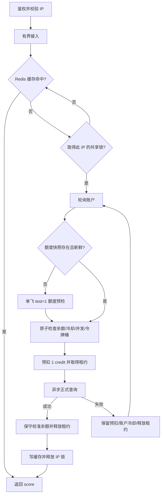

# Scamalytics score 服务设计

## 目标与边界

接受 IPv4 / IPv6，返回 Scamalytics 的 0–100 分及风险等级。采用 Python 3.13、uv、异步 FastAPI / HTTPX，Redis 在多个进程和容器之间共享 Key 池、额度、速率限制、并发租约、缓存和请求合并锁。无需为增加并发创建大量线程。

默认单进程可同时处理 512 个 score 查询，其中实际出站并发受 HTTP 连接池及各账户并发上限共同限制。这里的数值是资源边界，不是实际 QPS 承诺；吞吐量取决于账户合同、上游时延、独立账户数量和硬件。

## 官方接口核实

依据：[Scamalytics IP Fraud Risk API v3 官方文档](https://docs.scamalytics.com/ip-fraud-risk-api/v3/)。

- 认证同时需要 URL 路径中的 username 和查询参数中的 key。
- 通用文档列出 EU 的 `api12` 和 US 的 `api11`，实际账户凭证可能指定其他节点，例如 `api13`。以账户专属示例为准，通过 `api_host` 显式选择允许列表中的 `api11` / `api12` / `api13`，不猜测地理归属，也不跨节点自动重试。
- 正式查询使用 `ip` 参数；分数来自 `scamalytics.scamalytics_score`，同时校验 `status`、`mode`、IP、score 和 risk，拒绝把测试响应当成真实数据。
- 未发现单独公开的额度查询端点。实现利用 `test=1` 的响应读取 `scamalytics.credits`，不会凭空调用 `/balance` 一类端点。
- 测试调用不消耗正式 credits，但存在 fair-use 上限；免费账户文档给出的测试上限是每月 250 次。服务另设每账户每月最多 60 次的预检预算，不代表服务之外的测试调用也被统计。
- 每次成功正式查询消耗一个 credit；credits 是近似值，并有同步时间。额度按日历月重置。
- HTTP 200 仍可能包含 `status=error`，必须读取业务状态。

官方未明确给出所有套餐的统一 QPS、额度重置时区、补额协议或所有错误码。项目的速率值属于可配置的本地限制，应按合同调整；本地按 UTC 月份分桶，每月重新预检后才允许正式请求。即使供应商稍晚重置，返回的余额和错误仍会阻止盲目调用。

## 请求流程



所有路径受单次查询总超时限制。最多尝试 `MAX_ATTEMPTS` 个不同账户；首次预检也在总超时内。缓存命中不访问上游、不消耗额度。批量请求最多 1000 个 IP，每批仅创建 `BATCH_WORKERS` 个任务，按输入顺序返回每项结果。

## 账户池与一致性

配置中的一项是一组 `id + username + key + node`，可选 `api_host` 指定实际出站节点，`id` 为可公开的本地别名。同一 username 只能出现一次，包括指定不同 `api_host` 的情况，防止把同一账户的共享余额当成独立额度。多个不同 username 是否共享供应商合同额度无法从公开 API 判断；运营者必须保证配置的账户额度相互独立。

所有实例使用同一 Redis、前缀、账户配置和限流参数。Redis 内部沿用 node 与 username 的哈希标识账户，不保存明文 Key。未设置 `api_host` 时，`node=eu/us` 继续映射到 `api12/api11`。纠正 `api_host` 或轮换 Key 时保留原有 `node`，以复用账户余额、预检预算和租约；不要借修改 `node` 创建另一份账本。轮询起点在实例内变化，真正的准入由 Redis Lua 原子决定。某个账户不可用时会尝试池内其他账户。

`reserve.lua` 在一次原子操作中执行：

1. 清理到期租约，检查账户冷却状态。
2. 检查额度快照、有效期和安全余量。
3. 检查每账户共享并发上限和令牌桶。
4. 正式请求预扣一个 credit；预检请求登记月度测试计数并取得共享预检锁。
5. 记录有时限的并发租约。

令牌桶的容量为 `max(1, requests_per_second)`，允许约一秒的突发；不是严格滑动窗口。测试请求和正式请求共用并发及令牌桶。Redis 服务器时间用于租约、令牌和冷却，减少实例时钟差异。

余额更新遵守以下不变量：

```text
首次预检：local_remaining = max(0, reported_remaining - outstanding_leases)
每次预留：local_remaining -= 1
成功返回：local_remaining = min(local_remaining,
                                max(0, reported_remaining - outstanding_leases))
允许正式请求：local_remaining > QUOTA_SAFETY_MARGIN
```

同一 UTC 月内余额只减不增，所以旧快照和乱序响应不能重新放出已预留额度。成功响应会延长快照有效期，活跃账户通常不需要额外定期测试调用；账户闲置超过 `QUOTA_REFRESH_SECONDS`，再次使用前需要预检。`GET /v1/keys` 仅读取本地状态，不触发上游预检。

失败、超时、取消和崩溃可能已在上游完成计费，因此不返还预扣额度。这样会低估余额，尤其在故障密集时；服务优先限制额外调用。低于安全余量的账户本月停止发起正式请求，次月重新预检。月中充值不会自动提高本地余额，当前版本未提供强制补额接口。

该算法保证服务自身不会因并发竞争重复分配同一份本地余额；它不能把供应商的近似额度变成精确额度。其他系统共享账户、供应商同步滞后以及 Redis 数据丢失仍可能造成上游拒绝，安全余量和错误切换用于减少影响。

## 故障处理

| 情况 | 处理 |
| --- | --- |
| 401 / 403 或认证业务错误 | 账户冷却 300 秒并尝试其他账户 |
| 429 | 遵守 `Retry-After` 秒数或 HTTP 日期，冷却 1 秒到 24 小时 |
| credits exhausted / excess limit | 本月本地余额置零 |
| 网络、5xx、协议或其他业务错误 | 账户冷却 30 秒并尝试其他账户 |
| 没有可用账户 | 有界等待后返回 503 |
| 正式请求重试后仍失败 | 返回 502 |
| 单次查询总超时 | 返回 504 |
| Redis 不可用 | 返回 503，停止发出新的上游请求 |

`finally` 负责释放租约和 IP 锁，取消不缓存结果、不返还额度；进程崩溃时租约最多保留 `LEASE_SECONDS`。服务校验租约时间大于查询总超时加 2 秒。锁用随机 token 做比较删除，旧请求不能删除新持有者的锁。

旧的成功响应不会清除新产生的错误冷却。每月预检次数与余额状态持久化在 Redis；到下月使用新的预算状态。并发租约跨月份共享，避免月界瞬间突破并发上限。

## 存储与部署

Redis key 分为账户月度 Hash、账户共享租约 ZSET、预检锁、IP 查询锁和结果缓存。账户相关 key 使用相同 hash tag，Lua 脚本可落在同一槽；当前应用连接配置仅支持单节点 Redis，并未实现 Redis Cluster 客户端。月度状态在最后使用后保留 62 天，缓存默认保留 300 秒。

Compose 启用 Redis AOF 和独立数据卷，采用 `noeviction`，防止缓存挤掉额度状态。内存不足会返回服务错误，应监测并扩容，而不是清空状态。AOF 默认每秒刷盘，突然断电仍可能丢失最近约一秒的预留；严格计费系统需额外强化持久性并独立核账。

API 镜像使用 uv 的 frozen lock 安装，Python 3.13 多阶段构建，非 root 用户运行，默认一个异步 worker。扩容进程或容器时共用 Redis 即可共享账户限额；入口端口与负载均衡由部署者安排。

## 凭证与日志

真实 Key 只从 `config/keys.json` 或 Docker secret 挂载读取，不打包进镜像；服务调用令牌与 Scamalytics Key 分开。API 返回账户别名，不返回 username、Key 或上游原始错误。关闭 HTTPX 请求 INFO 日志，避免把 query string 中的 key 写入日志。HTTPX 不跟随重定向，也不隐式读取代理环境变量。诊断时同样不得打开包含完整上游 URL 的调试日志。

## 参考实现资料

- [HTTPX 异步客户端与连接复用](https://www.python-httpx.org/async/)
- [Redis Lua 原子执行语义](https://redis.io/docs/latest/develop/programmability/eval-intro/)
- [uv 官方 Docker 集成指南](https://docs.astral.sh/uv/guides/integration/docker/)
